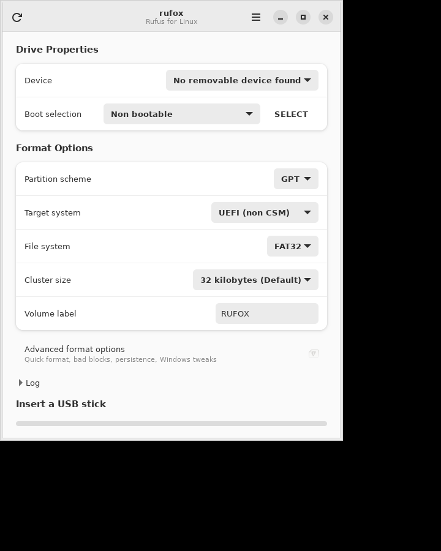

<div align="center">


# Rufox

**English** · [Русский](README.ru.md)

**A focused, native Linux utility for creating bootable USB drives.**
Rufus-inspired partitioning and image processing, with GTK4 and libadwaita.

[](https://github.com/dan1lazz/Rufox/actions/workflows/release.yml)
[](https://github.com/dan1lazz/Rufox/releases/latest)
[](LICENSE)

[Download](#download) · [Quick start](#quick-start) · [CLI](#command-line) · [Build from source](#build-from-source)



</div>

> [!WARNING]
> **Writing an image destroys all existing data on the selected target.** Check the device path and capacity before confirming. Rufox rejects known system disks, but no safeguard can replace a careful review.

## Download

| Architecture | AppImage | Checksum |
| --- | --- | --- |
| Intel / AMD 64-bit | [Rufox 0.2.0 for x86_64](https://github.com/dan1lazz/Rufox/releases/download/v0.2.0/Rufox-0.2.0-x86_64.AppImage) | [SHA-256](https://github.com/dan1lazz/Rufox/releases/download/v0.2.0/Rufox-0.2.0-x86_64.AppImage.sha256) |
| ARM 64-bit | [Rufox 0.2.0 for aarch64](https://github.com/dan1lazz/Rufox/releases/download/v0.2.0/Rufox-0.2.0-aarch64.AppImage) | [SHA-256](https://github.com/dan1lazz/Rufox/releases/download/v0.2.0/Rufox-0.2.0-aarch64.AppImage.sha256) |

The AppImage contains the GUI, CLI, privileged helper and their bundled runtime libraries. Formatting and bootloader operations still use standard host tools such as `mkfs.*`, `mtools`, `syslinux` and `pkexec` where required.

## Quick start

```bash
chmod +x Rufox-0.2.0-*.AppImage
./Rufox-0.2.0-*.AppImage
```

1. Insert a USB drive and select it in **Device**.
2. Choose an ISO or raw disk image with **SELECT**.
3. Review the partition scheme, target system and file system.
4. Press **START**, read the destructive-action summary and confirm.
5. Authorize the privileged helper through PolicyKit when asked.

The interface follows the system language by default. To choose English or Russian manually, open the top-right menu → **Preferences → Language**. The selection is saved and applied after restarting Rufox.

AppImage normally needs FUSE 2 (`libfuse2` on Debian/Ubuntu). If it is unavailable, run without installing anything:

```bash
./Rufox-0.2.0-*.AppImage --appimage-extract-and-run
```

For a non-destructive preview, start the GUI with `--dry-run`. The preview validates the image and target but does not open the target for writing.

## What works

- **Two write modes:** ISO extraction and raw DD copying with post-write verification.
- **Partition layouts:** GPT, MBR and superfloppy planning, including 4Kn-sector alignment and removal of stale primary/backup GPT data.
- **Boot targets:** UEFI and BIOS/CSM options, SYSLINUX MBR support and ISO bootloader configuration patches.
- **File systems:** FAT16, FAT32, exFAT, NTFS, ext2/3/4 and UDF through their native Linux formatting tools.
- **Safety:** system-disk filtering, exclusive device locking, write retries, cancellation and mandatory final synchronization.
- **Diagnostics:** image reports, MD5/SHA-1/SHA-256/SHA-512 hashing, bad-block checks, live progress, speed and ETA.
- **Localization:** English and Russian interfaces, with automatic system-language detection and an in-app selector.
- **Linux images:** optional persistent storage for supported Casper-based distributions.

### Current limitations

- **Windows To Go is not implemented.** Rufox refuses this mode explicitly; standard Windows installation media remains available.
- Compressed images must be decompressed before writing.
- Some advanced Rufus payload options need additional host packages or bootloader resources.
- AppImage packaging cannot install a system-wide PolicyKit policy. The desktop session must provide a working `pkexec` authentication agent for privileged GUI writes.
- This release is tested in Debian 13 with file-backed targets and application smoke tests; physical USB compatibility still needs broader hardware coverage.

## Command line

The same AppImage exposes the `rufox` CLI through `--cli`:

```bash
./Rufox-0.2.0-*.AppImage --cli list
./Rufox-0.2.0-*.AppImage --cli info -i /path/to/image.iso
./Rufox-0.2.0-*.AppImage --cli hash -i /path/to/image.iso -H sha256
./Rufox-0.2.0-*.AppImage --cli write -i /path/to/image.iso -d /dev/sdX --dry-run
```

Available commands: `list`, `info`, `plan`, `write`, `zero`, `hash` and `badblocks`. Use `--cli --help` for all options. The GUI accepts `--iso PATH`, `--device DEVICE`, `--filesystem NAME` and `--dry-run` for preselection.

## Build from source

<details>
<summary>Debian 13 / Ubuntu build dependencies</summary>

```bash
sudo apt install build-essential meson ninja-build pkg-config gettext \
  libglib2.0-dev libgtk-4-dev libadwaita-1-dev libgudev-1.0-dev \
  libudisks2-dev libblkid-dev libcdio-dev libiso9660-dev libudf-dev \
  libparted-dev zlib1g-dev liblzma-dev dosfstools mtools ntfs-3g \
  exfatprogs e2fsprogs syslinux-common isolinux xorriso
```

Install the GRUB package matching your machine architecture if you need GRUB-based targets: `grub-efi-amd64-bin` on x86_64 or `grub-efi-arm64-bin` on aarch64.

</details>

```bash
meson setup rufox/build rufox -Dgui=enabled -Dhotplug=enabled -Dudisks=enabled
meson compile -C rufox/build
meson test -C rufox/build --print-errorlogs
```

To install system-wide, use `sudo meson install -C rufox/build`. To build a release AppImage locally on Linux:

```bash
bash rufox/packaging/appimage/build-appimage.sh
```

The resulting file and SHA-256 checksum are written to `rufox/out/`.

## Project status and contributing

Rufox 0.2.0 includes graphical and command-line interfaces, AppImages for two architectures and Russian localization. The code is derived from **Rufus 4.15**, not a wrapper around `dd`: image analysis, partition planning, MBR handling and configuration patching are implemented in C. Bug reports and tested hardware reports are welcome in [Issues](https://github.com/dan1lazz/Rufox/issues).

## License and acknowledgement

Rufox is licensed under [GPL-3.0-or-later](LICENSE). It is derived from [Rufus](https://rufus.ie) by Pete Batard and contributors. Rufox is an independent Linux port and is not affiliated with or endorsed by the Rufus project.
