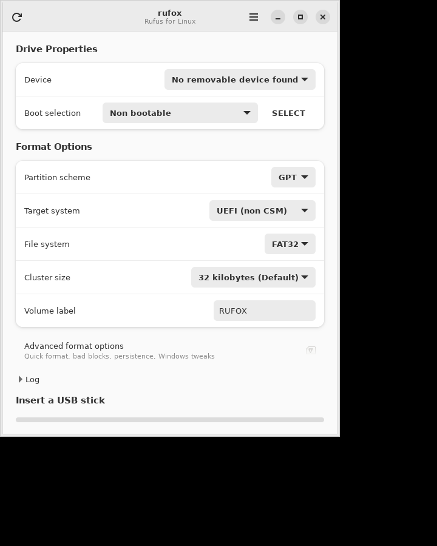

<div align="center">


# Rufox

[English](README.md) · **Русский**

**Нативная утилита для Linux, предназначенная для создания загрузочных USB-накопителей.**
Разметка и обработка образов в духе Rufus, интерфейс на GTK4 и libadwaita.

[](https://github.com/dan1lazz/Rufox/actions/workflows/release.yml)
[](https://github.com/dan1lazz/Rufox/releases/latest)
[](LICENSE)

[Скачать](#скачать) · [Быстрый старт](#быстрый-старт) · [Командная строка](#командная-строка) · [Сборка из исходного кода](#сборка-из-исходного-кода)



</div>

> [!WARNING]
> **Запись образа уничтожит все данные на выбранном накопителе.** Перед подтверждением проверьте путь к устройству и его ёмкость. Rufox отфильтровывает известные системные диски, но никакая защита не заменяет внимательную проверку.

## Скачать

| Архитектура | AppImage | Контрольная сумма |
| --- | --- | --- |
| Intel / AMD 64-bit | [Rufox 0.2.0 для x86_64](https://github.com/dan1lazz/Rufox/releases/download/v0.2.0/Rufox-0.2.0-x86_64.AppImage) | [SHA-256](https://github.com/dan1lazz/Rufox/releases/download/v0.2.0/Rufox-0.2.0-x86_64.AppImage.sha256) |
| ARM 64-bit | [Rufox 0.2.0 для aarch64](https://github.com/dan1lazz/Rufox/releases/download/v0.2.0/Rufox-0.2.0-aarch64.AppImage) | [SHA-256](https://github.com/dan1lazz/Rufox/releases/download/v0.2.0/Rufox-0.2.0-aarch64.AppImage.sha256) |

AppImage содержит графический интерфейс, CLI, помощник для привилегированных операций и необходимые библиотеки. Для форматирования и работы с загрузчиками по-прежнему используются стандартные системные инструменты: `mkfs.*`, `mtools`, `syslinux` и при необходимости `pkexec`.

## Быстрый старт

```bash
chmod +x Rufox-0.2.0-*.AppImage
./Rufox-0.2.0-*.AppImage
```

1. Вставьте USB-накопитель и выберите его в поле **«Устройство»**.
2. Нажмите **«ВЫБРАТЬ»** и укажите ISO или raw-образ диска.
3. Проверьте схему разделов, целевую систему и файловую систему.
4. Нажмите **«СТАРТ»**, прочитайте предупреждение об удалении данных и подтвердите операцию.
5. При появлении запроса авторизуйте привилегированный помощник через PolicyKit.

По умолчанию язык интерфейса соответствует языку системы. Чтобы выбрать английский или русский вручную, откройте меню в правом верхнем углу → **«Настройки» → «Язык»**. Выбор сохраняется и применяется после перезапуска Rufox.

Обычно AppImage требует FUSE 2 (`libfuse2` в Debian/Ubuntu). Если FUSE недоступен, запустите приложение без установки дополнительных компонентов:

```bash
./Rufox-0.2.0-*.AppImage --appimage-extract-and-run
```

Для безопасного предварительного просмотра запустите GUI с параметром `--dry-run`. В этом режиме проверяются образ и целевое устройство, но устройство не открывается для записи.

## Возможности

- **Два режима записи:** распаковка ISO и побитовое копирование DD с последующей проверкой.
- **Схемы разделов:** GPT, MBR и superfloppy, включая выравнивание для дисков 4Kn и удаление остатков основной и резервной GPT.
- **Загрузка:** UEFI и BIOS/CSM, поддержка SYSLINUX MBR и изменение конфигурации загрузчиков ISO.
- **Файловые системы:** FAT16, FAT32, exFAT, NTFS, ext2/3/4 и UDF через соответствующие инструменты Linux.
- **Безопасность:** фильтрация системных дисков, исключительная блокировка устройства, повторные попытки записи, отмена и обязательная финальная синхронизация.
- **Диагностика:** отчёты об образах, MD5/SHA-1/SHA-256/SHA-512, проверка повреждённых секторов, отображение прогресса, скорости и оставшегося времени.
- **Образы Linux:** дополнительный раздел постоянного хранилища для поддерживаемых дистрибутивов на базе Casper.
- **Интерфейс:** русский и английский языки, автоматический выбор по языку системы.

### Текущие ограничения

- **Windows To Go не реализован.** Rufox явно отклоняет этот режим; обычный установочный носитель Windows по-прежнему доступен.
- Сжатые образы перед записью необходимо распаковать.
- Некоторым дополнительным функциям Rufus требуются отдельные системные пакеты или ресурсы загрузчика.
- AppImage не может установить системную политику PolicyKit. Для привилегированной записи из GUI в сеансе рабочего стола должен работать `pkexec` и authentication agent.
- Релиз проверен в Debian 13 с файловыми образами и автоматическими smoke-тестами; совместимость с физическими USB-накопителями требует более широкого тестирования оборудования.

## Командная строка

Тот же AppImage предоставляет CLI `rufox` через параметр `--cli`:

```bash
./Rufox-0.2.0-*.AppImage --cli list
./Rufox-0.2.0-*.AppImage --cli info -i /путь/к/образу.iso
./Rufox-0.2.0-*.AppImage --cli hash -i /путь/к/образу.iso -H sha256
./Rufox-0.2.0-*.AppImage --cli write -i /путь/к/образу.iso -d /dev/sdX --dry-run
```

Доступные команды: `list`, `info`, `plan`, `write`, `zero`, `hash` и `badblocks`. Полный список параметров выводится командой `--cli --help`. GUI принимает параметры `--iso PATH`, `--device DEVICE`, `--filesystem NAME` и `--dry-run` для предварительного выбора.

## Сборка из исходного кода

<details>
<summary>Зависимости для сборки в Debian 13 / Ubuntu</summary>

```bash
sudo apt install build-essential meson ninja-build pkg-config gettext \
  libglib2.0-dev libgtk-4-dev libadwaita-1-dev libgudev-1.0-dev \
  libudisks2-dev libblkid-dev libcdio-dev libiso9660-dev libudf-dev \
  libparted-dev zlib1g-dev liblzma-dev dosfstools mtools ntfs-3g \
  exfatprogs e2fsprogs syslinux-common isolinux xorriso
```

Если нужны целевые устройства с GRUB, установите пакет, соответствующий архитектуре компьютера: `grub-efi-amd64-bin` для x86_64 или `grub-efi-arm64-bin` для aarch64.

</details>

```bash
meson setup rufox/build rufox -Dgui=enabled -Dhotplug=enabled -Dudisks=enabled
meson compile -C rufox/build
meson test -C rufox/build --print-errorlogs
```

Для установки в систему выполните `sudo meson install -C rufox/build`. Чтобы собрать релизный AppImage локально в Linux:

```bash
bash rufox/packaging/appimage/build-appimage.sh
```

Готовый файл и контрольная сумма SHA-256 сохраняются в `rufox/out/`.

## Статус проекта и участие в разработке

Rufox 0.2.0 включает графический и командный интерфейсы, пакеты AppImage для двух архитектур и русскую локализацию. Код основан на **Rufus 4.15** и не является оболочкой над `dd`: анализ образов, планирование разделов, работа с MBR и изменение конфигурации реализованы на C. Сообщения об ошибках и результаты тестирования оборудования приветствуются в [Issues](https://github.com/dan1lazz/Rufox/issues).

## Лицензия и благодарности

Rufox распространяется по лицензии [GPL-3.0-or-later](LICENSE). Проект основан на [Rufus](https://rufus.ie), созданном Pete Batard и участниками проекта. Rufox — независимый порт для Linux, не связанный с проектом Rufus и не имеющий его официальной поддержки.
